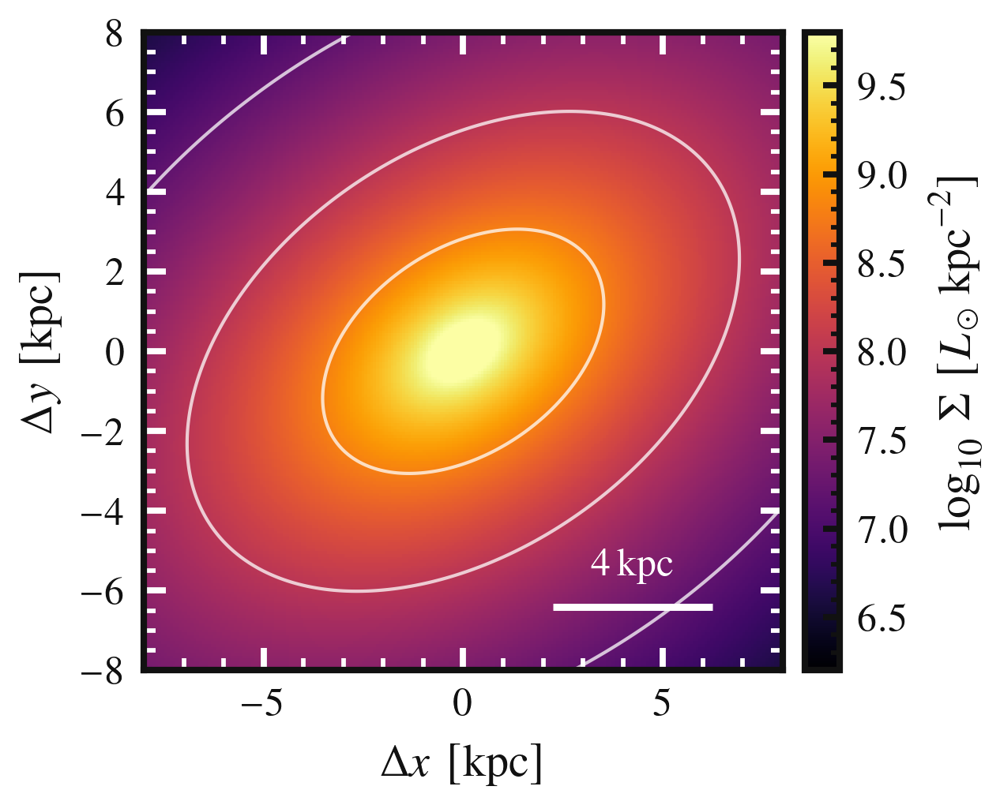
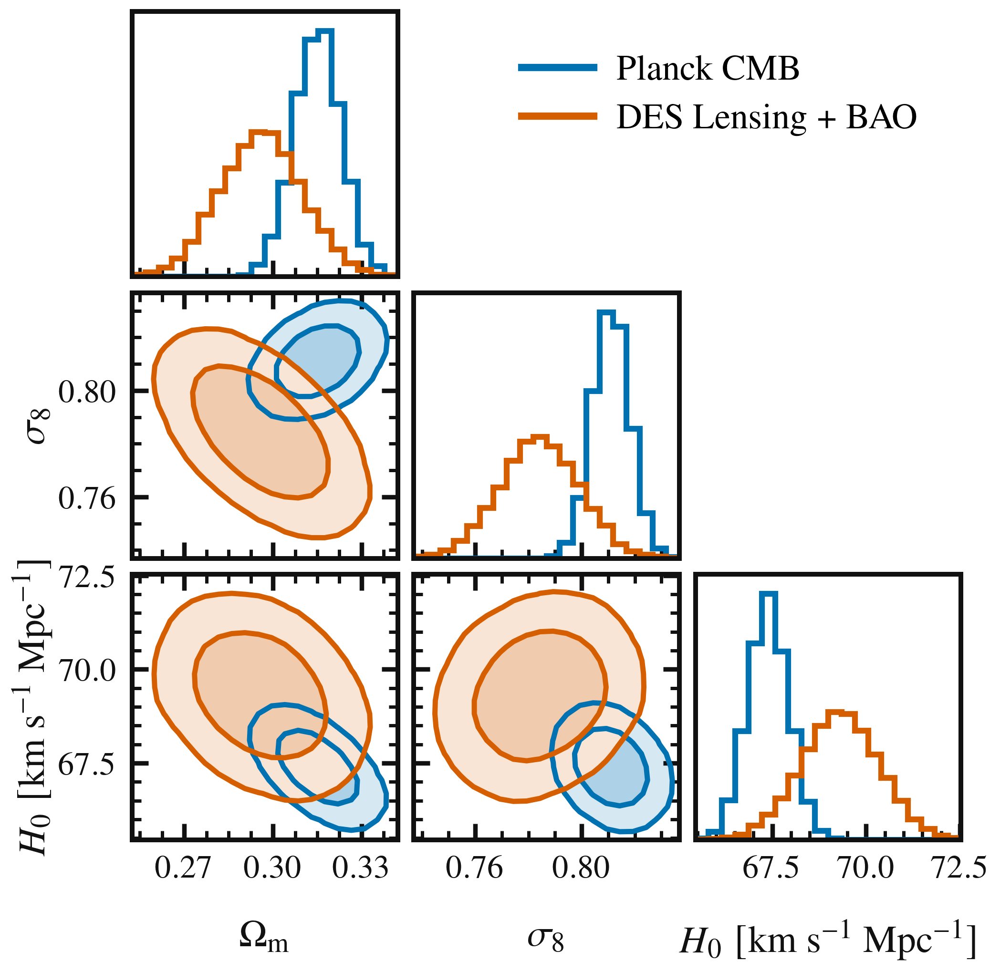

# astrostyle

Publication-ready Matplotlib figures for astrophysics papers (ApJ/AJ, MNRAS, A&A, Nature Astronomy), plus a short contract that AI coding agents can follow.

## Features

- **Journal-agnostic widths**: `SINGLE_COL = 3.50 in` and `DOUBLE_COL = 7.10 in` fit every major astro journal within about 4%.
- **Width-aware styling**: frame weight, inward major and minor ticks on all four sides, and font sizes scale with figure width, so wide grids and corner plots keep readable text.
- **LaTeX when available**: `usetex="auto"` uses real LaTeX (`amsmath`, `newtx`) when `latex` and `dvipng` work, and falls back to STIX mathtext otherwise. Labels are linted, and stray `%`, `&` and `#` are escaped.
- **Figure builders**: `fig_xy`, `fig_residuals`, `fig_image`, `fig_wcs`, `fig_grid` and `fig_corner` (square panels, with or without the `corner` package), plus `add_inset`, `add_beam`, `add_scalebar` and `label_panels`.
- **Works with any figure**: `astro.save` / `astro.polish` apply the style to figures from the builders, plain Matplotlib, GridSpec or seaborn. They also rasterize dense layers, warn about overlapping tick labels, and write a vector `.pdf` plus a 300 dpi `.png`.
- **Agent-ready**: `astrostyle-init` adds a short pointer to `python -m astrostyle.guide` to a project's `AGENTS.md`/`CLAUDE.md`.

---

## Gallery

Every figure below comes from [`examples/generate_gallery.py`](examples/generate_gallery.py) with no manual tweaking: build with an archetype, plot, then `astro.save(...)`.

<table>
  <tr>
    <td align="center" width="50%"><br><sub><code>fig_residuals</code>: spectrum + residual panel</sub></td>
    <td align="center" width="50%"><br><sub><code>fig_xy</code>: luminosity distance vs. redshift</sub></td>
  </tr>
  <tr>
    <td align="center"><br><sub><code>fig_image</code> + <code>add_scalebar</code>: surface-brightness map</sub></td>
    <td align="center"><br><sub><code>fig_corner</code>: two-chain MCMC posterior</sub></td>
  </tr>
</table>

Regenerate them (rendered with full LaTeX when `latex` and `dvipng` are on `PATH`):

```bash
python examples/generate_gallery.py docs/gallery
```

---

## Installation

Install directly from GitHub into your project environment:

```bash
pip install "git+https://github.com/timedilatesme/astrostyle.git"
# Optional extras for Astropy WCS maps and external corner.py:
pip install "astrostyle[all] @ git+https://github.com/timedilatesme/astrostyle.git"
```

Initialize the compact 5-line `AGENTS.md` + 1-line `CLAUDE.md` stub in your project root:

```bash
astrostyle-init .
```

Any AI agent working on your project will now run `python -m astrostyle.guide` and follow your exact plotting style automatically.

---

## Quick Start

```python
import matplotlib.pyplot as plt
import astrostyle as astro

# Optional, once per project: every builder inherits these settings.
astro.apply_style(context="paper", palette="okabe_ito", usetex="auto")

# 1D publication curve
fig, ax = astro.fig_xy(width=astro.SINGLE_COL)
ax.plot(z, d_l, label=r"$\Lambda\mathrm{CDM}$")
ax.set_xlabel(astro.ASTRO_LABELS["redshift"])
ax.set_ylabel(astro.ASTRO_LABELS["luminosity_distance"])
ax.legend()
astro.save(fig, "figures/distance_redshift")

# 3-parameter MCMC corner plot (strictly 1:1 square panels)
fig, axes = astro.fig_corner(
    [chain_planck, chain_des],
    labels=[astro.ASTRO_LABELS["omega_m"], astro.ASTRO_LABELS["sigma_8"], astro.ASTRO_LABELS["h0"]],
    names=[r"Planck CMB", r"DES Lensing + BAO"],
)
astro.save(fig, "figures/posterior_corner")

# Per-figure override (doesn't change the project defaults)
fig, ax = astro.fig_xy(context="talk", palette="tol_bright")

# Any hand-built Matplotlib figure: style first, save through astrostyle
astro.apply_style(width=astro.DOUBLE_COL)
fig, axes = plt.subplots(1, 3, figsize=(astro.DOUBLE_COL, 2.6))
astro.save(fig, "figures/custom_layout")
```

## Tests

```bash
python -m unittest discover -s tests -v
```
