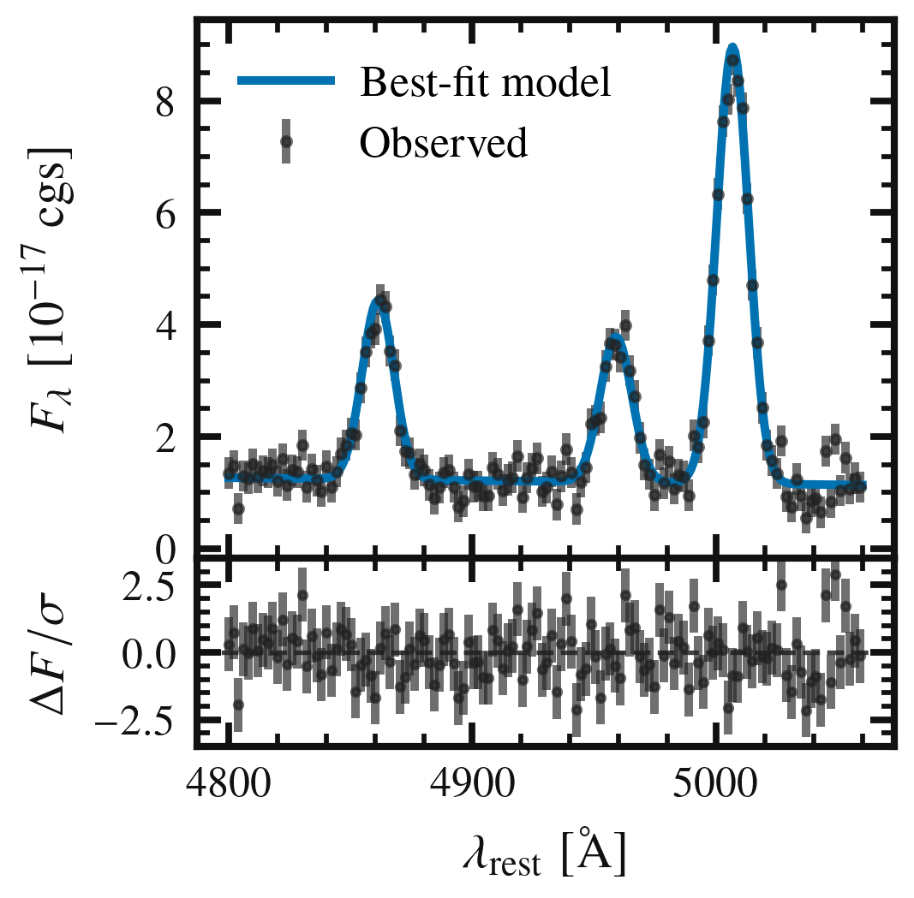
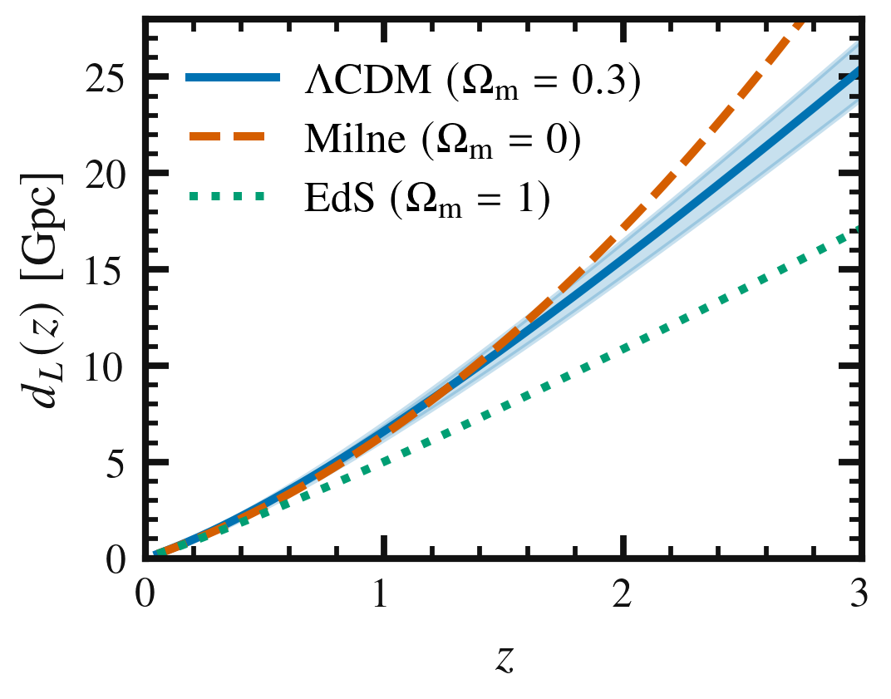

# astrostyle

Dynamic, journal-agnostic publication plotting package + AI-agent contract for astrophysics papers (ApJ/AJ/ApJS, MNRAS, A&A, Nature Astronomy).

## Key Features

- **Journal-Agnostic Print Widths**: `SINGLE_COL = 3.50 in` and `DOUBLE_COL = 7.10 in` drop into ApJ, MNRAS, A&A, and Nature Astronomy with <= ±4% rescaling.
- **Width-Proportional Dynamic Styling**: Bold frames (`2.4 pt` base), prominent **inward major and minor ticks on all four sides**, and large bold typography automatically scale with figure width so wide grids and corner plots never suffer from tiny text.
- **Bulletproof LaTeX Rendering (`usetex="auto"`)**: Uses full LaTeX (`amsmath`, `amssymb`, `bm`, `newtxtext`/`newtxmath`) whenever `latex` + `dvipng` are available, and seamlessly falls back to STIX mathtext on clusters or containers without TeX—plus built-in LaTeX label linting and `%`/`&` escaping.
- **Aspect-Locked Archetypes**: `fig_xy`, `fig_residuals`, `fig_image`, `fig_wcs`, `fig_grid`, `fig_corner` (strictly `1:1` square panels, works with or without `corner` installed), `add_inset`, `add_beam`, and `add_scalebar`.
- **Universal Post-Processor (`astro.polish` / `astro.save`)**: Enforces inward ticks, white ticks over dark heatmaps, auto-rasterization for `> 3,000` scatter points, tick-collision linting, and dual vector `.pdf` + `300 dpi` `.png` export.
- **Zero-Copy AI Agent Workflow**: Bundle rules once inside this repo; point any coding agent (Cursor, Claude Code, Codex, Copilot) to `python -m astrostyle.guide`.

---

## Gallery

Every figure below comes from [`examples/generate_gallery.py`](examples/generate_gallery.py) with no manual tweaking: build with an archetype, plot, then `astro.save(...)`.

<table>
  <tr>
    <td align="center" width="50%"><br><sub><code>fig_residuals</code>: spectrum + residual panel</sub></td>
    <td align="center" width="50%"><br><sub><code>fig_xy</code>: luminosity distance vs. redshift</sub></td>
  </tr>
  <tr>
    <td align="center"><br><sub><code>fig_image</code> + <code>add_scalebar</code>: surface-brightness map</sub></td>
    <td align="center"><br><sub><code>fig_corner</code>: two-chain MCMC posterior</sub></td>
  </tr>
</table>

Regenerate them (rendered with full LaTeX when `latex` and `dvipng` are on `PATH`):

```bash
python examples/generate_gallery.py docs/gallery
```

---

## Installation

Install directly from GitHub into your project environment:

```bash
pip install "git+https://github.com/timedilatesme/astrostyle.git"
# Optional extras for Astropy WCS maps and external corner.py:
pip install "astrostyle[all] @ git+https://github.com/timedilatesme/astrostyle.git"
```

Initialize the compact 5-line `AGENTS.md` + 1-line `CLAUDE.md` stub in your project root:

```bash
astrostyle-init .
```

Any AI agent working on your project will now run `python -m astrostyle.guide` and follow your exact plotting style automatically.

---

## Quick Start

```python
import astrostyle as astro

# 1D publication curve
fig, ax = astro.fig_xy(width=astro.SINGLE_COL)
ax.plot(z, d_l, label=r"$\Lambda\mathrm{CDM}$")
ax.set_xlabel(astro.ASTRO_LABELS["redshift"])
ax.set_ylabel(astro.ASTRO_LABELS["luminosity_distance"])
ax.legend()
astro.save(fig, "figures/distance_redshift")

# 3-parameter MCMC corner plot (strictly 1:1 square panels)
fig, axes = astro.fig_corner(
    [chain_planck, chain_des],
    labels=[astro.ASTRO_LABELS["omega_m"], astro.ASTRO_LABELS["sigma_8"], astro.ASTRO_LABELS["h0"]],
    names=[r"Planck CMB", r"DES Lensing + BAO"],
)
astro.save(fig, "figures/posterior_corner")
```

## Tests

```bash
python -m unittest discover -s tests -v
```
